# HTML-in-Canvas: a catalog of techniques

Felix Rieseberg published [The Explainer](https://claude.ai/artifact/7cCNqKnoFSoib9SuNLB3vk) about HTML-in-Canvas, a new Chromium feature that is now switched on in Claude. It has 8 scrolling scenes and links to 15 demos. I went through all of them, read their source (it's heavily commented), and screenshotted each one. This README lists every technique I found, with ideas on where you might use it.

**The core idea: a real web page becomes a texture you can draw anywhere, and it keeps working.** The browser lays out ordinary HTML (text, buttons, inputs, video) inside a `<canvas>`. It hands the canvas a live picture of that HTML. Your WebGL code draws the picture on silk, jelly, glass shards, a 3D cube, whatever you like. Then you tell the browser where each part ended up, so clicks, typing, selection, find-in-page, translation and screen readers all still work on the bent copy.

The Explainer's "How it works" scene puts it in 4 steps:

1. **Lay it out.** The browser arranges the words, as on any page.
2. **Take its picture.** It hands the canvas a picture, and takes a new one when anything changes.
3. **Bend it.** Your code puts that picture on any shape.
4. **Point back.** When someone points at the bent copy, your code finds the matching spot on the flat copy. The browser then knows which word is there.

[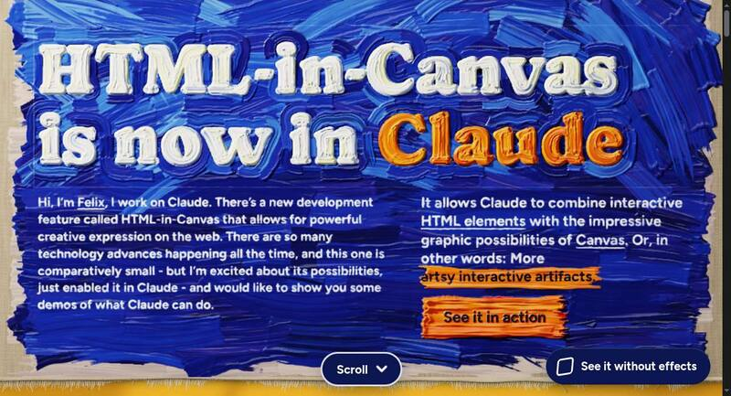](https://claude.ai/artifact/7cCNqKnoFSoib9SuNLB3vk)

## Where it works, and the API to use

According to the Explainer (November 2026), it's on in **Chrome 157+**, **Edge 157+** and **Claude's desktop apps 5.11492+**. Safari and Firefox don't have it yet.

The API has had two generations. **Use the current one:**

| | Current (Chrome / Edge 157+) | Earlier (Chromium before 157, e.g. the Claude desktop app) |
|---|---|---|
| Mark the canvas | `<canvas content="drawable">` | `<canvas layoutsubtree>` |
| Upload the HTML into a WebGL texture | `gl.texElementSubImage2D(...)` into a texture you allocated, at any size | `gl.texElementImage2D(...)`, which allocates the texture itself |
| Tell the browser where an element is drawn (for hit testing) | `canvas.updateElementGeometry(...)` | none: move the element with a CSS `transform` instead |
| Know when to re-upload | the canvas `paint` event (`canvas.onpaint`), plus `canvas.requestPaint()` | same |
| Draw with Canvas 2D or WebGPU instead | `ctx.drawElementImage(...)`, `queue.drawElementImageToTexture(...)` | `ctx.drawElement(...)`, `queue.copyElementImageToTexture(...)` |

(The 2D and WebGPU names come from the demos' feature probe, which lists each pair in the same order as the WebGL pair. I'm inferring which is current from that order. All the demos themselves draw with WebGL2.)

All 16 artifacts detect support by **probing for these names, never by browser version**, and fall back to a plain HTML page (with a video of the demo) when neither is there. Some builds (Chrome 154-156, per the comments) have `updateElementGeometry` but ignore it for clicks, so the demos test it once and fall back to a CSS transform. If you ask Claude to build with this, maybe mention both generations so it writes the same kind of adapter.

To try it in Claude, the Explainer suggests a prompt like this:

> Make an artifact that uses HTML-in-Canvas. Put the following design on a sheet that flows in the wind: [Insert your idea here]

## The demos

| | | |
|---|---|---|
| [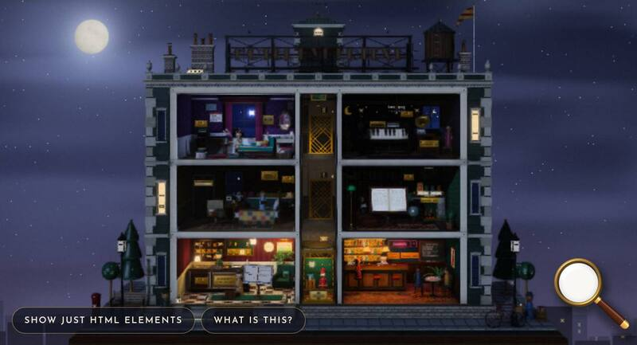](https://claude.ai/artifact/WgPzNowvy1DGy3jeXhzNMD) [**Hotel Hypertext**](https://claude.ai/artifact/WgPzNowvy1DGy3jeXhzNMD): a lit dollhouse hotel. Every control is a real form element on an object in a room. A magnifying lens shows the plain, unstyled HTML underneath. | [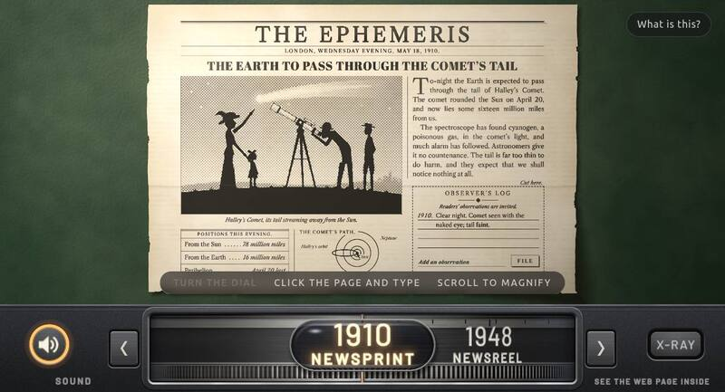](https://claude.ai/artifact/VtYey85VQXYqqfURRYqpiq) [**Time Machine**](https://claude.ai/artifact/VtYey85VQXYqqfURRYqpiq): one page through 7 display technologies, from 1910 newsprint to 2026 OLED. Turn a dial, type, scroll to magnify. | [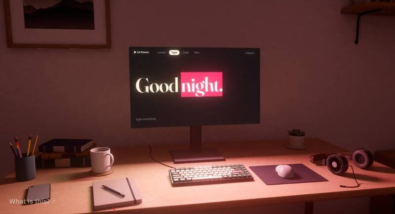](https://claude.ai/artifact/D5pdvChFfvxBsvVNb5KNCJ) [**Lit Room**](https://claude.ai/artifact/D5pdvChFfvxBsvVNb5KNCJ): a desk at night. The live page on the monitor is the light source for the room. You can even edit its CSS. |
| [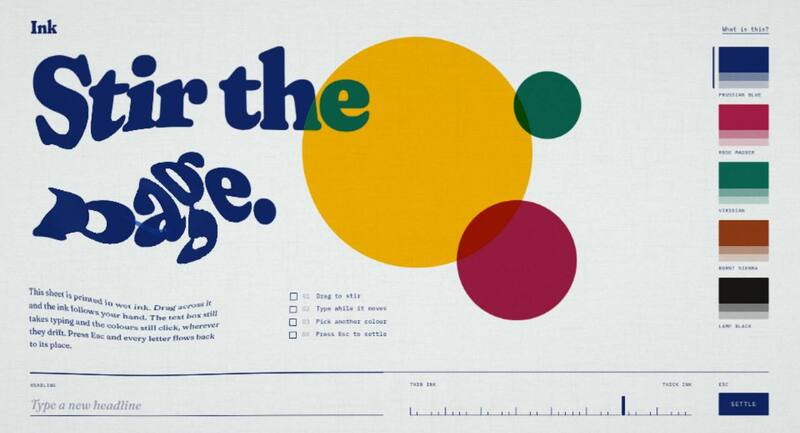](https://claude.ai/artifact/WEmmb18oUbyCSkYyB1JMiB) [**Ink**](https://claude.ai/artifact/WEmmb18oUbyCSkYyB1JMiB): the page is wet marbling ink. Drag to stir it. The text box and swatches keep working while they drift. Esc flows it back. | [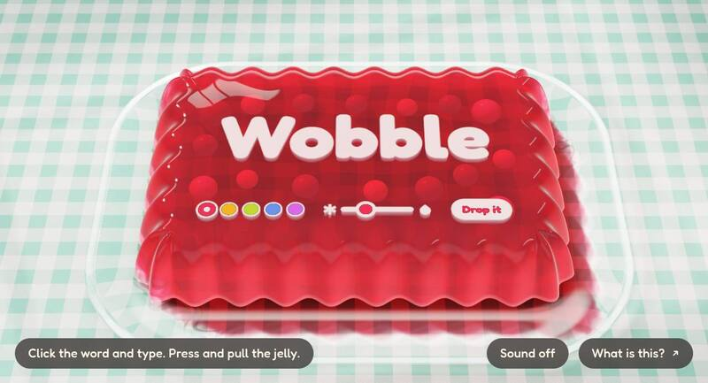](https://claude.ai/artifact/HGJRkas2J1QTVjctgi5A7V) [**Jelly**](https://claude.ai/artifact/HGJRkas2J1QTVjctgi5A7V): the page is set in a wobbling jelly on a glass plate. Press and pull it, drop it, melt it with a slider. | [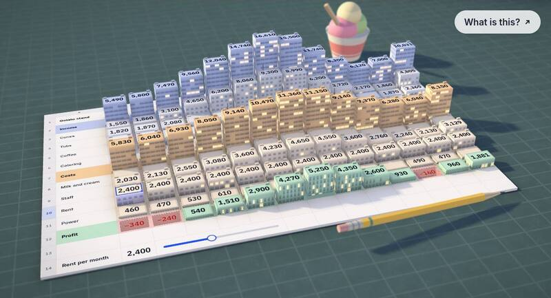](https://claude.ai/artifact/VZ6Un8f7RzJArq7wqMrE72) [**Sheet City**](https://claude.ai/artifact/VZ6Un8f7RzJArq7wqMrE72): a real spreadsheet drawn as a model city. Each number is a building, losses are pits. Edit a cell and the towers change. |
| [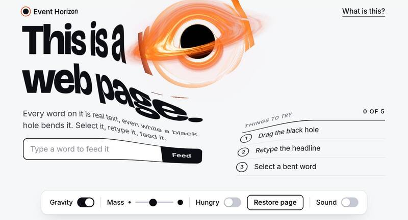](https://claude.ai/artifact/YLk8PESrskZLHiAiyqUZHN) [**Event Horizon**](https://claude.ai/artifact/YLk8PESrskZLHiAiyqUZHN): a black hole bends the page with real gravitational lensing. Words stay selectable. Feed it a word, or let it eat the page. | [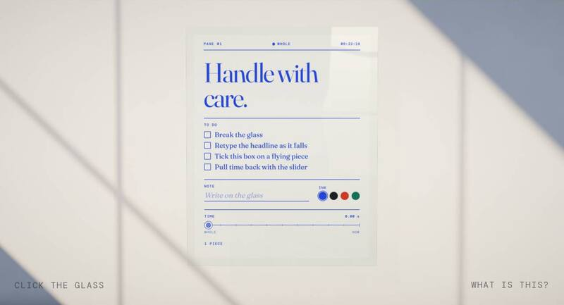](https://claude.ai/artifact/Berg7ureW47JTrMNVoH8TU) [**Shatter**](https://claude.ai/artifact/Berg7ureW47JTrMNVoH8TU): a page printed on glass. Break it, tick a checkbox on a flying shard, then scrub time backwards to mend it. | [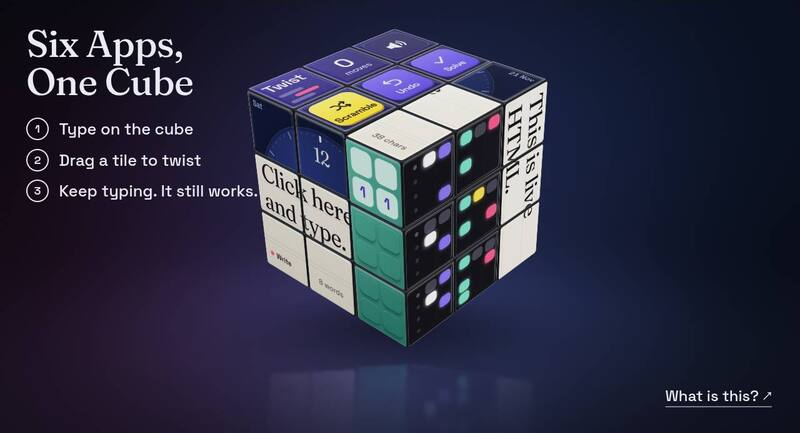](https://claude.ai/artifact/287yYEVG3FekMqofmJkUki) [**Six Apps, One Cube**](https://claude.ai/artifact/287yYEVG3FekMqofmJkUki): a Rubik's cube whose faces are 6 small apps (writer, drawing, clock, beat sequencer, minesweeper, remote). Twist it and keep typing. |
| [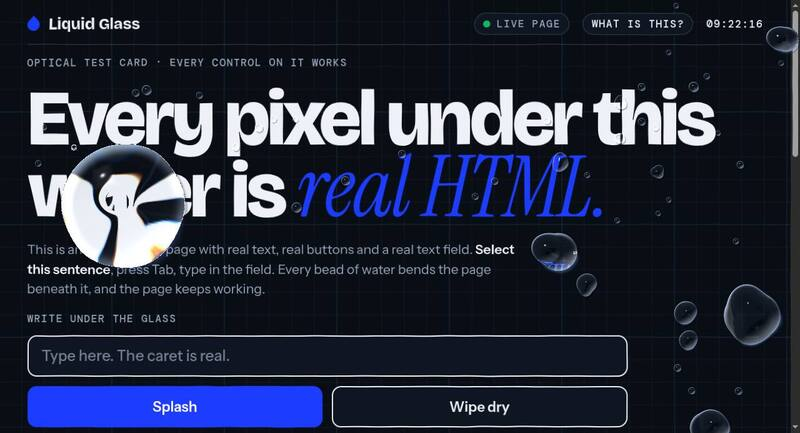](https://claude.ai/artifact/CxxmVRwFgSmV9xB7XFsjbf) [**Liquid Glass**](https://claude.ai/artifact/CxxmVRwFgSmV9xB7XFsjbf): water drops on a live test card. Each bead is a lens. Rain, a big draggable drop, refractive index from air to diamond. | [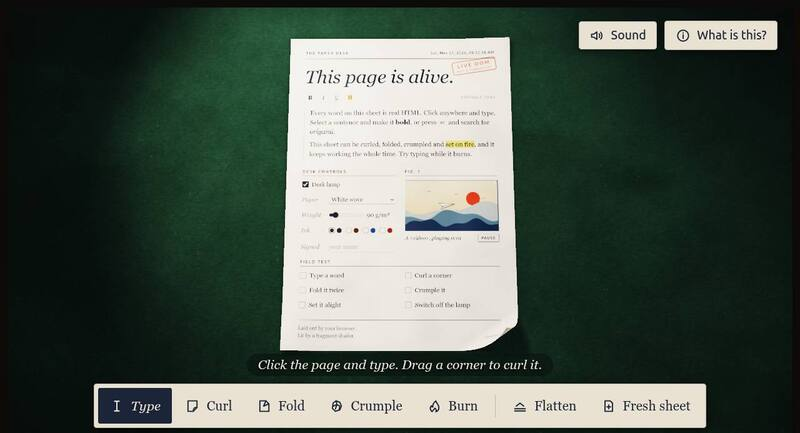](https://claude.ai/artifact/BKGBk584YpYtxBebEQsYSm) [**The Paper Desk**](https://claude.ai/artifact/BKGBk584YpYtxBebEQsYSm): a sheet of paper with a rich-text editor and a playing `<video>`. Curl, fold, crumple, burn it. It keeps working while it burns. | [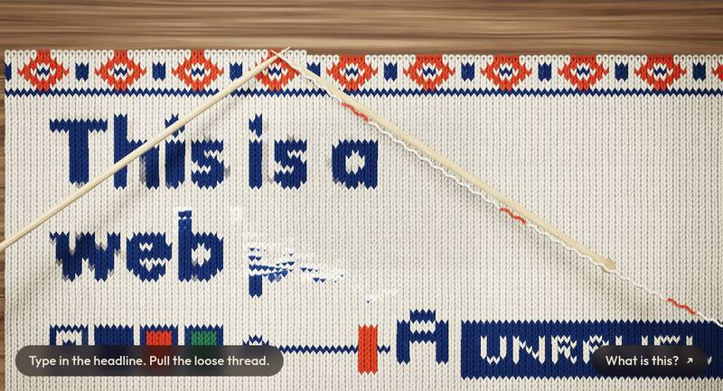](https://claude.ai/artifact/Y8uZf2xz48joUiM1nPhxLW) [**Knitted Page**](https://claude.ai/artifact/Y8uZf2xz48joUiM1nPhxLW): the page drawn stitch by stitch in wool. Type and the new letters get knitted in. Pull the loose thread to unravel it. |
| [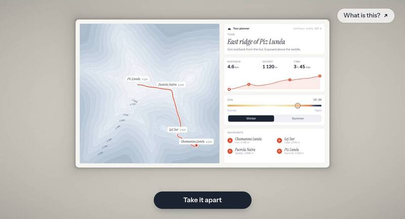](https://claude.ai/artifact/CBxLSFEFnojedyQW5L458v) [**Exploded View**](https://claude.ai/artifact/CBxLSFEFnojedyQW5L458v): a hiking tour planner whose contour map lifts into a stacked paper mountain. A sun slider lights it from sunrise to night. | [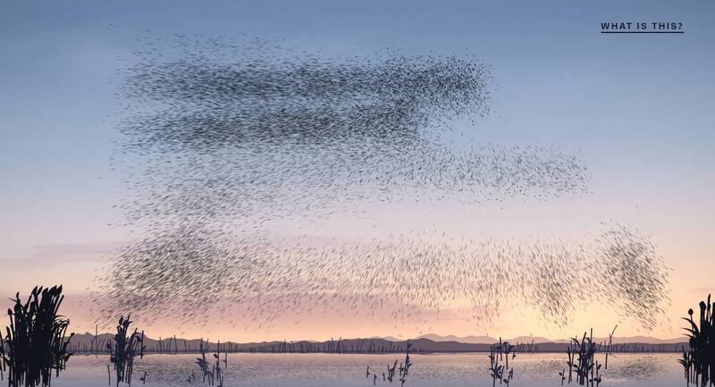](https://claude.ai/artifact/NfKoLhxvZ9AcX32i9CBvHU) [**Swarm**](https://claude.ai/artifact/NfKoLhxvZ9AcX32i9CBvHU): at dusk the page takes off as a murmuration of starlings, then lands back as text. Typed words get written in the sky. | [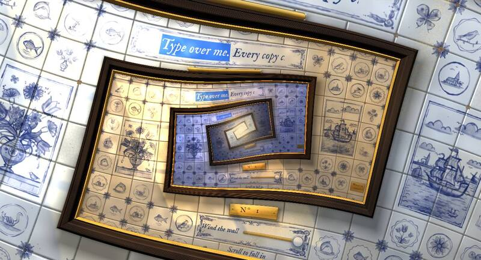](https://claude.ai/artifact/RjZStie469yP8BUZGKAiUY) [**Droste**](https://claude.ai/artifact/RjZStie469yP8BUZGKAiUY): a Delft-tile wall holding a framed picture of itself, forever. Type in one copy, and all copies change. Scroll to fall in. |

And the 8 scenes of [The Explainer](https://claude.ai/artifact/7cCNqKnoFSoib9SuNLB3vk) itself:

| | | | |
|---|---|---|---|
|  **Oil paint**: the title is a raking-lit oil painting. Selecting text drags a wet orange brush stroke over it. | 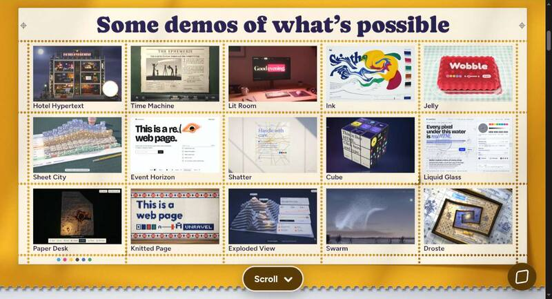 **Stamps**: the demo gallery is a sheet of postage stamps. Hover peels a stamp off along its perforations. | 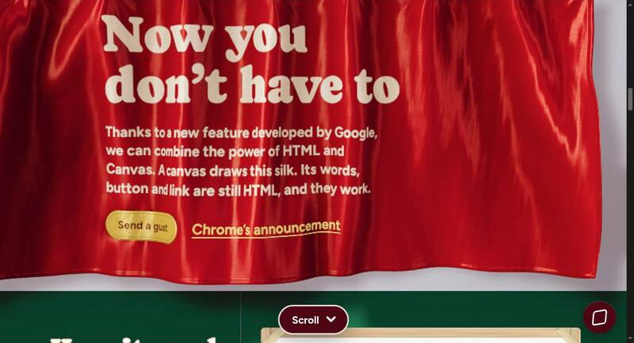 **Silk**: a red silk curtain carrying live text and a button. "Send a gust" blows wind across it. | 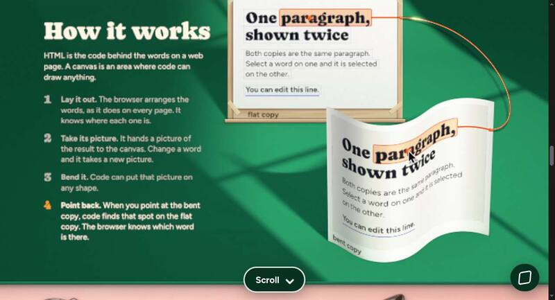 **How it works**: one paragraph shown flat on a drawing board and bent on a curling photo print. Select on one, it selects on both. |
| 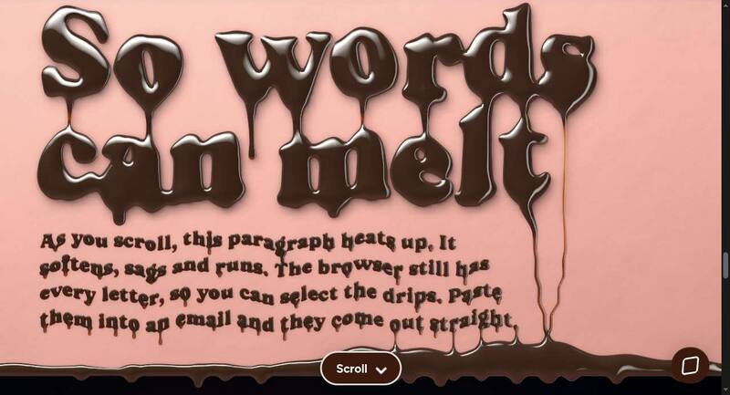 **Melt**: the headline melts like chocolate as you scroll. You can still select the drips and paste them as clean text. | 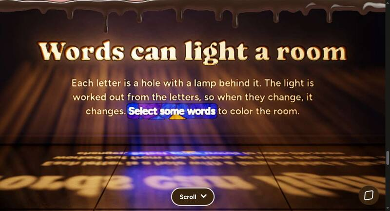 **Lamp**: letters are holes cut in a wall with a lamp behind. Light shafts and floor pools come from the words. | 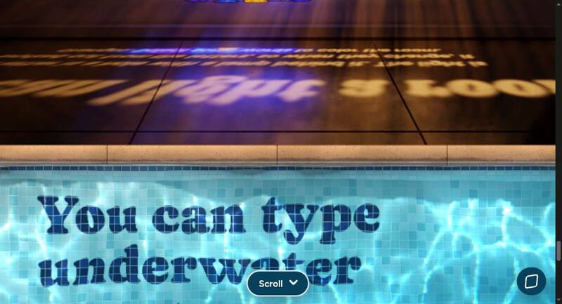 **Pool**: words are mosaic tiles at the bottom of a sunlit pool. You can type underwater, and each letter makes a ripple. | 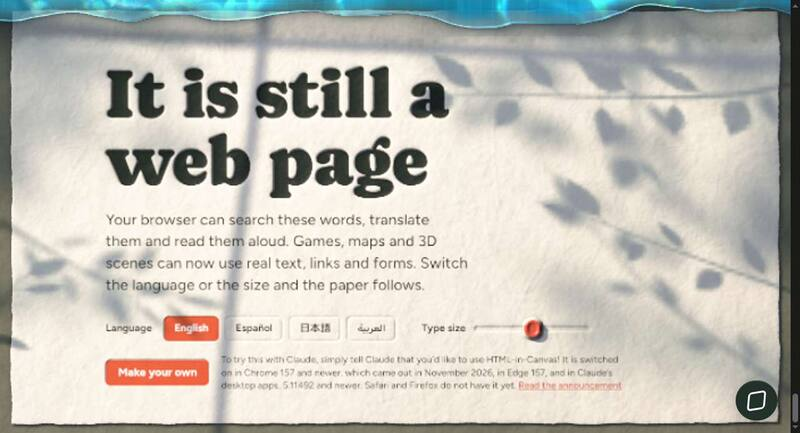 **Paper**: letterpress on cotton paper under a tree's dappled shadow. Switch language or type size and the impression is pressed again. |

## Technique catalog

Each line below is one technique: what it looks like, where it's used, and a few ideas for where you could use it. I've grouped them by what they do to the page.

### 1. Print the page on a material

The simplest family. Keep the HTML where layout put it (or nearly), and shade it as if it were made of something.

- **Fabric in the wind.** A cloth simulation drapes a live page over a silk curtain hanging from clips on a brass rod. Moving the pointer stirs the air; a button sends a gust that sweeps across. ([Explainer: Silk](https://claude.ai/artifact/7cCNqKnoFSoib9SuNLB3vk)) *Try:* a festival banner whose schedule you can click, a flag with a signup form on it, a theatre curtain that opens onto the real content, a sail carrying a regatta leaderboard.
- **Thick oil paint.** Text and background are repainted as hundreds of knife and brush strokes that follow the letterforms, then lit by a raking lamp so the impasto casts shadows. (Explainer: title) *Try:* a gallery or museum landing page, an artist portfolio whose bio is "painted", a wedding invitation in gouache.
- **Letterpress on cotton paper.** Headlines and buttons are pressed into the sheet, small type is printed flat, a wax seal stands up, and a tree throws moving leaf shadows over it all. Switching language lifts the old impression out and presses the new one in. (Explainer: Paper) *Try:* stationery, certificates, menus, a multilingual invitation, legal documents that feel like paper.
- **Knitted wool.** Every 10x8 px "stitch" takes its colour from the page underneath, drawn as real yarn. Changes get re-knitted row by row, like real knitting. Pull the loose thread to unravel the page. ([Knitted Page](https://claude.ai/artifact/Y8uZf2xz48joUiM1nPhxLW)) *Try:* a craft shop, a holiday-sweater greeting card, a "progress bar" that knits as a form fills, any page with a cosy, low-resolution charm. The same idea works for cross-stitch, LEGO bricks, pixel mosaics, beads.
- **Jelly.** The page is suspended in a fluted, translucent jelly that refracts the tablecloth, casts coloured shadows, and has fruit set inside it. ([Jelly](https://claude.ai/artifact/HGJRkas2J1QTVjctgi5A7V)) *Try:* a kids' game, a dessert brand, a "squishy" confirmation dialog, any UI that should feel playful and physical.
- **Glass.** The page is printed on a pane of glass with green edges, a polished floor reflection and sunlight through a window. ([Shatter](https://claude.ai/artifact/Berg7ureW47JTrMNVoH8TU)) *Try:* a "fragile, handle with care" warning, a shop window with a live price list.
- **Wet ink and marbling.** The page is floating ink on water. A drag combs it into marbled ribbons; pigments don't mix into mud but push each other aside. ([Ink](https://claude.ai/artifact/WEmmb18oUbyCSkYyB1JMiB)) *Try:* a bookbinding or stationery brand, a poetry site, a calm "fidget" home page.
- **Halftone newsprint, film, CRT, VHS, LCD, e-ink, OLED.** The same live page rendered through 7 eras of display tech, down to halftone dots, silver grain, phosphor scanlines, tape tracking errors, LCD ghosting, e-ink microcapsules and OLED subpixels. ([Time Machine](https://claude.ai/artifact/VtYey85VQXYqqfURRYqpiq)) *Try:* a "this day in history" site, retro game menus, a museum of computing, a brand story told decade by decade, a nostalgic theme switcher for any app.
- **Mosaic tiles under water.** Every line height and margin is a whole number of tiles, so letters sit cleanly on the grout grid. (Explainer: Pool) *Try:* a swimming club or spa site, a summer campaign, a calm meditation app.
- **Ceramic tiles.** Hand-painted Delft-blue tiles, cracked glaze, grout, a gilt frame and a brass plate whose number is a live digit. ([Droste](https://claude.ai/artifact/RjZStie469yP8BUZGKAiUY)) *Try:* a heritage brand, a restaurant menu, a kitchen-showroom catalog.
- **Postage stamps.** The gallery is a perforated sheet on marigold paper. Selecting text over a stamp cancels it with a red postmark. (Explainer: Stamps) *Try:* a gallery of products, team members or blog posts; a travel site; a collection or achievements page.
- **Chocolate.** Letters soften, sag, drip and pool as you scroll, lit like a glossy poured surface. (Explainer: Melt) *Try:* a dessert brand, a summer heat-wave news story, a "deadline is melting" countdown.
- **Cut card, paper models, desk props.** A contour map turns into a stack of laser-cut paper sheets on a drafting mat; a spreadsheet turns into a model city on a desk next to a pencil and a cup of gelato. ([Exploded View](https://claude.ai/artifact/CBxLSFEFnojedyQW5L458v), [Sheet City](https://claude.ai/artifact/VZ6Un8f7RzJArq7wqMrE72)) *Try:* architecture or real-estate sites, trip planners, physical-looking dashboards.

### 2. Let physics move the page

Here the page moves, and the HTML has to be found again after every frame (see "Point back" in section 8).

- **Soft body wobble.** The slab sways, twists, rocks and squashes as 11 ringing springs. Pressing pulls the bit of jelly under the pointer; "Drop it" squashes and ripples it; temperature changes wobble from 3 Hz (cold, firm) to 1.4 Hz (warm, loose). ([Jelly](https://claude.ai/artifact/HGJRkas2J1QTVjctgi5A7V)) *Try:* bouncy notification cards, a "shake to undo" panel, a playful pricing page where the plan you pick wobbles.
- **Cloth simulation.** Position-based dynamics on a coarse 64x40 grid, smoothed with a B-spline to the mesh you draw. Wind is value noise; the pointer pushes the cloth to the wall. ([Explainer: Silk](https://claude.ai/artifact/7cCNqKnoFSoib9SuNLB3vk)) *Try:* the flag or curtain idea above, a laundry line of product cards, a tablecloth menu that ripples as you hover.
- **Paper that curls, folds, crumples and burns.** Drag a corner to curl it; fold it twice; crumple it into sharp facets; set it alight. The rich-text editor, video and checkboxes still work throughout. ([Paper Desk](https://claude.ai/artifact/BKGBk584YpYtxBebEQsYSm)) *Try:* a "delete account" page you literally crumple, a letter you fold into an envelope to send, burn-after-reading notes, a fun "discard draft" interaction.
- **Glass fracture with a rewindable timeline.** Radial and ring cracks split the pane into convex shards, which fly, bounce, stack and slide as rigid bodies. The simulation is recorded on a "tape", so a slider scrubs time backwards and gold seams mend it (kintsugi). You can type on a falling shard. ([Shatter](https://claude.ai/artifact/Berg7ureW47JTrMNVoH8TU)) *Try:* an error page that breaks, a "break the glass in case of emergency" CTA, an undo history you can scrub, a before/after story.
- **Fluid stirring with undo.** The stir is a flow map stored as a "film" of snapshots, so Esc runs it backwards and every letter flows home. Fine print pulled too far blurs into a bleed instead of tearing. ([Ink](https://claude.ai/artifact/WEmmb18oUbyCSkYyB1JMiB)) *Try:* a distortion you can always reset, a "mess it up then tidy" toy, a calming loading screen.
- **Water ripples and rain.** A damped wave equation runs on a texture; each typed letter drops a ripple, a deleted letter leaves a closing dimple, a click on bare floor splashes, the pointer leaves a wake. Drops on glass merge, run down and gather at the bottom edge. ([Explainer: Pool](https://claude.ai/artifact/7cCNqKnoFSoib9SuNLB3vk), [Liquid Glass](https://claude.ai/artifact/CxxmVRwFgSmV9xB7XFsjbf)) *Try:* a rainy-day weather site, typing feedback in a journaling app, a "wipe to reveal" interaction.
- **Gravity.** A black hole bends light from the page using real general-relativity light paths (`u'' = 3u^2 - u`). Drag it, change its mass, or turn on "Hungry" and it tears words off the page into glowing strands that spiral in. ([Event Horizon](https://claude.ai/artifact/YLk8PESrskZLHiAiyqUZHN)) *Try:* a space or physics explainer, a "delete" that swallows items, a page where the focus element pulls everything else toward it.
- **Melting.** Scroll heats the text: a signed-distance field of the letters is sagged, swollen and joined by drip "tongues" that grow from the real bottoms of glyphs and find the gaps between words below. The pointer is warm, so drips near it run early. ([Explainer: Melt](https://claude.ai/artifact/7cCNqKnoFSoib9SuNLB3vk)) *Try:* a climate story, a sale that "melts" prices, a playful 404.

### 3. Break the page into pieces

- **Flocking particles.** Every pixel of the page becomes a grain that flies off as a starling murmuration and lands back in place. Typed words line up enlarged in the sky. Sorting a table makes each row's grains fly from the old position to the new. ([Swarm](https://claude.ai/artifact/NfKoLhxvZ9AcX32i9CBvHU)) *Try:* page transitions, a data table that animates sorting, a "the page takes off at dusk" night mode, birds that spell out a sale message.
- **Shards.** Pieces of a live page (see Shatter above). *Try:* breaking a card into the parts of a dashboard, an exploding "share" button.
- **Strands.** Words are copied onto a fine mesh that stretches into glowing threads as it falls in ([Event Horizon](https://claude.ai/artifact/YLk8PESrskZLHiAiyqUZHN)). *Try:* deleting list items, a "send" animation where the message gets sucked into the outbox.
- **Stitches and thread.** Unravelling a knitted page ([Knitted Page](https://claude.ai/artifact/Y8uZf2xz48joUiM1nPhxLW)). *Try:* reveal hidden content beneath, a "pull to refresh" that literally pulls a thread.
- **Tiles flipping.** In the pool, a selection turns tiles gold one after another at random rates. *Try:* split-flap airport boards, a scoreboard, a dramatic reveal of results.
- **Exploded layers.** The flat page lifts into stacked sheets: first the contour layers thicken into a solid mountain, then gaps open from the top down. Click a sheet to lift it and everything above. ([Exploded View](https://claude.ai/artifact/CBxLSFEFnojedyQW5L458v)) *Try:* showing the layers of a UI or a design system, an org chart, an anatomy or product teardown, explaining how a web page is built from boxes.

### 4. Put the page in 3D space

- **Apps on the faces of a cube.** Each face is a 720px square of ordinary HTML cut into 9 tiles. Twisting the cube moves tiles between apps, and the beat sequencer plays the tiles in their current order, so a twist rearranges the groove. ([Cube](https://claude.ai/artifact/287yYEVG3FekMqofmJkUki)) *Try:* a dashboard where widgets live on faces of a shape, a puzzle game made of real forms, a product configurator.
- **Controls on objects in a dollhouse.** A quilt is a live panel, a chalkboard is a text area, the neon roof sign is an editable `<h1>`, the lift is a vertical `<input type="range">` whose thumb is the brass lever, the piano keyboard is a live octave. ([Hotel Hypertext](https://claude.ai/artifact/WgPzNowvy1DGy3jeXhzNMD)) *Try:* a smart-home control panel as a cutaway house, a museum floor plan with real exhibit pages, a game settings menu set in a room, a hotel booking site where you pick your room in the building.
- **Data extruded into buildings.** One storey per 1,000; losses dig pits; totals stand behind the rows they add up. Editing a cell sends light along the grid lines to the cells that depend on it, and results count up when the light arrives. A shallow depth of field keeps live text sharp. ([Sheet City](https://claude.ai/artifact/VZ6Un8f7RzJArq7wqMrE72)) *Try:* budgets, sales by region, election results, any spreadsheet you want people to feel and still edit.
- **A screen inside a room.** The page lives on a monitor on a desk, with keyboard, mug, headphones and plant. ([Lit Room](https://claude.ai/artifact/D5pdvChFfvxBsvVNb5KNCJ)) *Try:* product shots that are actually live (a phone mock-up you can use), portfolio case studies, retro computer simulations.
- **A page on a curved print.** The same paragraph on a flat board and on a curling S-shaped photo print, both selectable. (Explainer: How it works) *Try:* a book whose pages curve, a scroll or parchment, a curved stadium screen.
- **Infinite recursion (Droste effect).** A conformal (log-polar) map draws the page inside itself again and again; each copy hangs at a different hour of the day. Scroll to fall in. ([Droste](https://claude.ai/artifact/RjZStie469yP8BUZGKAiUY)) *Try:* a portfolio that zooms into itself, a "rabbit hole" story, a mirror of mirrors for an art piece. A conformal map is locally just move-turn-scale, which is exactly what a CSS matrix can say, so clicks still work.

### 5. Let the page give off light

- **Letters as windows for a lamp.** Each letter is a hole in a thick plaster wall with one lamp behind. From the text alone they compute a glow, light shafts in dusty air, letters projected onto the floor, and a mirror reflection in polished concrete. Selecting text knocks a ragged opening glazed with stained glass, and the room turns that colour. ([Explainer: Lamp](https://claude.ai/artifact/7cCNqKnoFSoib9SuNLB3vk)) *Try:* a theatre or night-club site, a "light up your name" greeting, a church or cathedral event page.
- **A live page lighting a room.** The monitor's content is the light source: change the page colours and the desk, mug and walls change with it. Type a word, restyle the sign, play a film, drag a lamp. ([Lit Room](https://claude.ai/artifact/D5pdvChFfvxBsvVNb5KNCJ)) *Try:* show how a dark theme feels at night, a music player whose album art lights the room, a mood-lighting app.
- **Neon and glow.** Hotel Hypertext's roof sign is an editable heading; the glow on the roof follows how much sign is lit. Night scenes light waypoint lamps along a route. *Try:* signage you can edit, a bar menu, a "now open" sign.
- **Caustics.** Sunlight refracted through a water surface onto the pool floor, split a little by colour. The jelly's fluted shoulder focuses light into bright bands on the plate. *Try:* a summer theme, anything with water or glass.
- **Sun and shadow that move.** A sun slider moves light from sunrise to night over a paper mountain, with long amber shadows at dawn and moonlight later. A tree's leaves throw dappled shadows over letterpress paper and sway with the pointer. ([Exploded View](https://claude.ai/artifact/CBxLSFEFnojedyQW5L458v), Explainer: Paper) *Try:* time-of-day themes, real-estate "see the sunlight in this room" tools, a garden journal.

### 6. Look at the page through optics

- **Water drops as lenses.** Each bead holds a tiny upside-down copy of the page around it; a big drop is a magnifier; refraction follows Snell's law, sampled 5 times across the spectrum for dispersion. Text down to 5px stays selectable and searchable. ([Liquid Glass](https://claude.ai/artifact/CxxmVRwFgSmV9xB7XFsjbf)) *Try:* an accessibility magnifier that looks lovely, a "read the fine print" gag on terms and conditions, a rainy window over a weather widget.
- **A magnifying lens that reveals the plain HTML.** Inside the lens you see the unstyled form elements on drafting paper; outside, the lit hotel. "Show just HTML elements" flips the whole scene. ([Hotel Hypertext](https://claude.ai/artifact/WgPzNowvy1DGy3jeXhzNMD)) *Try:* teaching HTML/CSS, a "view the wireframe" lens for design reviews, an X-ray mode in a game. Time Machine has a similar X-RAY button.
- **Gravitational lensing.** See Event Horizon. *Try:* any "focus" effect that pulls attention to one element.
- **Refraction through moving water.** Words at the bottom of a pool bend with the swell and the ripples. (Explainer: Pool)
- **Zoom to the microstructure.** Scroll to magnify in Time Machine and you get halftone dots, film grain clumps, phosphor slot masks, e-ink capsules. *Try:* a "zoom in until you see the pixels" explainer, a print-quality preview.
- **Depth of field.** Sheet City focuses on whatever the pointer is on and masks live text out of the blur. *Try:* tilt-shift model views of maps and dashboards.

### 7. Turn selection, caret, focus and hover into the material

This was the most delightful part for me. **The browser's own interaction states become part of the art.**

The trick ("data colours"): style the hidden page in a few pure colours (black ink, `#0f0` accent, `#f00` selection background, `#00f` selected text). The shader reads those as four masks from one picture and turns each into a material. You never see the pure colours.

- **Selection as a wet brush stroke** over a dry oil painting (title), **a red postmark** cancelling the selected words (stamps), **gold lame woven into silk** (silk), **yellow highlighter** with streaks and a wet rim (how it works), **mint icing** that flows over the chocolate (melt), **a stained-glass opening** that colours the room (lamp), **tiles turning gold** (pool), **a leaf-green wash** brushed on paper (page). *Try:* selection that looks like a marker in a study app, like a laser in a sci-fi game, like a fingerprint on glass.
- **The caret as part of the material.** A strip of lit orange glass refracted with the letters (pool); a caret two stitches wide that gets knitted (knit). *Try:* a typewriter carriage, a quill, a blinking neon bar.
- **Typing as an event in the world.** Each keystroke drops a ripple; a typed letter starts at the surface and sinks (pool); keystrokes play notes on a 5-note scale so a typed word becomes a tune (jelly); words get written in the sky by birds (swarm). *Try:* a typing tutor, a poem-writing toy, a chat app where messages float away.
- **Focus and hover as physical lift.** A stamp peels up under the pointer or with keyboard focus; a button's hover, pressed and focus looks are baked in paint (title); bands of the paper mountain light up under the pointer; embroidered badges brighten. *Try:* cards that lift like paper, buttons that press into felt.
- **Interaction states stay accessible.** Because these are real elements, keyboard focus works, and when focus lands in an off-screen stage, the Explainer scrolls it into view.

### 8. Point back: keep the bent page clickable

These are the engineering techniques that make all of the above usable. Mostly for builders.

- **Unproject.** For any screen point, compute which point of the flat HTML is drawn there, using the same maths as the shader (ray against the cloth mesh, ray against a curled print, undo the sag of melting letters, undo refraction, invert a conformal map).
- **Local affine fit around the pointer.** Even when the drawing is bent, a small neighbourhood is roughly a matrix. Sample a few unproject calls around the pointer, take the Jacobian, invert it, and give the browser that matrix (via `updateElementGeometry`, or a CSS transform on older builds). The letter under the pointer is then the letter the browser finds.
- **Only the tile under the pointer is hittable.** On the cube, only the tile under the pointer gets a hit area (its on-screen quad as a homography, clipped). During a press the clip opens up so drags and selections can run past the edge.
- **CPU mirror of the GPU simulation.** The pool reads back a small window of the ripple height field around the pointer and steps it on the CPU, so hit testing refracts the same way the picture does. Ink reads back a small copy of the flow map a frame later without stalling.
- **Probe, don't guess.** Move the element by an odd amount and check whether its box follows, to see if `updateElementGeometry` really moves clicks. Decide once, never by version.
- **Clear the hit-test cache.** Chrome keeps the last hit-test result after a geometry change; touching an attribute on an element outside the canvas makes it look again.
- **Safety net.** A tap gives no pointer move first, so the geometry can be a frame old. Each demo works out which control is *drawn* under the press, and if the browser hit something else, delivers the click to the right control.
- **Drags shouldn't steal the caret.** Pulling jelly, twisting the cube or pressing bare glass must not take focus out of the text field someone is typing in.

### 9. Keep it a real web page

These are not visual effects, but they're why this matters over a plain WebGL scene.

- **Search, translate, read aloud.** Find-in-page finds text on a melted, refracted or knitted page. Screen readers read it as a normal paragraph. (Explainer: Paper, Liquid Glass)
- **Copy and paste comes out clean.** Select the chocolate drips and paste them into an email: the text comes out straight.
- **Real forms, video and editors.** Rich-text editing (bold, italic), checkboxes, sliders, radio groups, `<select>`, `<time>`, and a playing `<video>`, all inside the effect. ([Paper Desk](https://claude.ai/artifact/BKGBk584YpYtxBebEQsYSm), [Hotel](https://claude.ai/artifact/WgPzNowvy1DGy3jeXhzNMD))
- **Real layout drives the art.** Change the language (English, Spanish, Japanese, Arabic) or type size and the letterpress reflows and re-presses. The melting drips are computed from the real glyph bottoms and word gaps. Lit Room lets you **edit the CSS** of the sign; the browser parses it.
- **Real spreadsheet logic.** Formulas, in-cell editing, undo, all in plain DOM ([Sheet City](https://claude.ai/artifact/VZ6Un8f7RzJArq7wqMrE72)).
- **A "see it without effects" switch.** The Explainer morphs every scene into a flat poster of the same layout. Hotel Hypertext shows just the HTML elements. Good for accessibility, debugging and teaching.
- **Graceful fallback.** Without the feature, a shared `unsupported.js` shows a plain page with the steps to enable it and a video of the demo. Without WebGL, the page is ordinary HTML. If no picture of the page ever arrives, or the canvas stays black, they switch to the plain page instead of showing nothing.

### 10. Make it feel alive

- **Scroll as a timeline.** Each Explainer section is pinned while you scroll through it: the lamp swings in an arc, chocolate melts, the camera pulls back, the curtain widens. Every pose is a pure function of scroll, so scrolling back undoes it. *Try:* scrollytelling reports, product launches, annual reports.
- **Self-demonstration.** If nobody touches the page, it shows itself off: selects a few words, types over a headline, plays the film, drags a lamp, takes one word out of the headline and gives it back. It gives way as soon as you touch anything. *Try:* onboarding that demonstrates the real UI on itself.
- **Synthesized sound.** Jelly, Cube, Shatter, Event Horizon, Droste, Sheet City, Exploded View and Hotel all build sound from oscillators and noise (no samples): jelly creaks and boings, glass modal resonances, tile "tinks" from the modes of a square plate, paper riffles that speed up with scrolling. Notes are on pentatonic scales so any sequence sounds fine. *Try:* tactile feedback for forms, sound design for data changes.
- **Seeded randomness.** The painting, the melt, the tree and the stamps use seeded generators, so the same page always looks the same. Good for screenshots and tests.

## Things to borrow for performance

Mostly from code comments, in case you're building one:

- **Bake what doesn't move, relight what does.** Paint or bake textures once per layout, then each frame only re-lights them (oil painting, letterpress, stamps).
- **Re-upload the page only when it changes**, in the `paint` event. Detect real text changes with a small "ink fingerprint" thumbnail, so a selection change doesn't rebuild everything.
- **Adaptive resolution.** Draw into a smaller buffer while things move, upscale with a bicubic filter, then one full-resolution frame when everything stops. Step quality down when frames are late, back up when there's room. Cap at 60 fps on 120 Hz screens.
- **Fixed substeps** for springs and simulations, so motion is the same at any frame rate.
- **Mipmaps for tilted text.** The element texture can't hold mipmaps, so Shatter copies it into an ordinary texture that can. Otherwise small text on tilted shards shimmers.
- **Test hooks.** `__X.t.pose(...)` puts a scene in a known state for repeatable screenshots; `#hits` in some demos outlines where the browser thinks each control is.

## What I'm left wondering

Every demo here spends a lot of code on point-back and hit-test workarounds. That's probably the hard part, and it seems to be what makes Claude useful here: these artifacts write the adapter, the probe and the safety net each time. I didn't try building one myself yet. Maybe the cheapest first project is the Explainer's own suggestion: put an existing form on a flag in the wind and see what breaks.

## Files

- [`notes.md`](notes.md): how I collected this, and what I learned along the way.
- [`images/`](images/): screenshots of all 15 demos and 8 Explainer scenes (taken 21 Nov 2026 in Chrome, 1280x760).
- [`tools/`](tools/): the scripts I used to extract comments and take background-tab screenshots via CDP.
