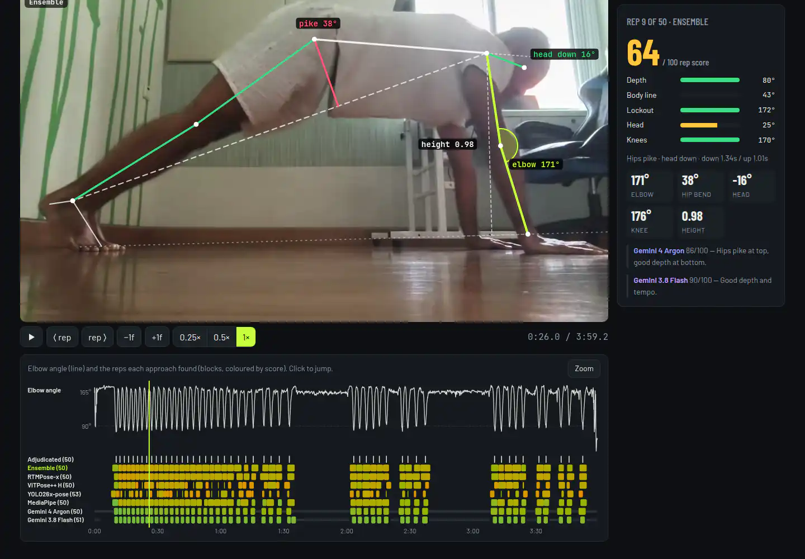

# Push-up form lab

**Question:** How good are my push-ups, rep by rep? And what's the best tool to measure that from a phone video?

**Answer:** Use a 2D pose model (RTMPose-x, or a median ensemble of four models) and score joint angles. Don't use a vision-language model to score. Across 230 reps in four sessions, depth was never the problem. The body line was. Hips **sagged** on 7 Nov, the sag was fixed by 11 Nov (best session, 87/100), and then it was **overcorrected into a pike** by 15 Nov (67/100).

**[Open the page →](index.html)** It shows every rep with angles drawn on the video, click-to-prove metrics, and a side-by-side / overlay / swipe / flicker comparison of approaches. It works from `file://` too.



## Your push-ups

Ensemble scores (0–100, weighted: depth 30%, body line 30%, lockout 15%, head 15%, knees 10%):

| Session | Reps | Score | Depth | Body line | Hips | Lockout | Head | Knees |
|---|---:|---:|---:|---:|---|---:|---:|---:|
| 7 Nov | 60 | 71 | 100 | 23 | **sag** in 95% of reps | 78 | 91 | 89 |
| 8 Nov | 60 | 78 | 100 | 63 | mixed (55% pike) | 87 | **41** | 98 |
| 11 Nov | 60 | **87** | 100 | 62 | slight pike (97%) | 94 | 97 | 100 |
| 15 Nov | 50 | 67 | 100 | **6** | **pike** in 98% of reps | 100 | 68 | 100 |

- **Depth is fine everywhere.** The median elbow angle at the bottom is 78–85°, past the 90° standard.
- **7 Nov:** the hips **sag** (median 26°), and the fast first set (~0.9 s/rep) never fully locks out (elbows peak at ~151° in the first 30 reps).
- **8 Nov:** the body line improved (median 15°), but the head drops (neck bent a median 30° off the spine line).
- **11 Nov:** everything good at once. The hips sit slightly high, which is mostly fine.
- **15 Nov:** hips **pike** at the top of each rep (median 36°, middle half of reps 29–43°), then flatten at the bottom. Lockout is perfect (173°). This is the sag fix pushed too far.
- **Fix:** keep the hip on the dashed shoulder-to-ankle line (the overlay shows it), neither below nor above. The page draws it on every frame.

Is the trend real or a camera artefact? The camera setup is near-identical across days: floor tilt −0.7° to −1.6°, body incline 17.3–18.4°, body length 73–82% of frame width. Angles are therefore comparable across days. The ranking is also stable (`stability.py`, 500 random ±30% perturbations of every threshold and weight):

- **11 Nov is best in 100% of perturbations** for the ensemble, RTMPose and ViTPose (MediaPipe 99%, YOLO 83%).
- **8 Nov is second in 90–98%** for the ensemble, RTMPose and ViTPose.
- **7 Nov vs 15 Nov depends on the model**: the ensemble, RTMPose and ViTPose put 7 Nov ahead (91–100%), but MediaPipe puts 15 Nov ahead (71%). The two sessions have opposite faults (sag vs pike) with similar penalties, so treat them as roughly tied.

## Which approach to trust

| Approach | Rep recall · precision | Reps 7/8/11/15 Nov | Score 7/8/11/15 Nov | Agree % | Jitter px | ms/frame | Verdict |
|---|---|---|---|---:|---:|---:|---|
| **Ensemble** (median of the 4 below) | 100% · 100% | 60/60/60/50 | 71/78/87/67 | – | – | ~420 | **Use this.** One model's glitch gets outvoted |
| **RTMPose-x** ([rtmlib](https://github.com/Tau-J/rtmlib), Halpe26) | 100% · 100% | 60/60/60/50 | 68/76/87/64 | 95.8 | 4.1 | 63 | **Best single model**: accurate, steady, feet keypoints, ONNX |
| ViTPose++-H ([transformers](https://huggingface.co/docs/transformers/model_doc/vitpose)) | 100% · 100% | 60/60/60/50 | 73/79/88/61 | 96.2 | 4.5 | 111 | As accurate, 1.5–2× slower, CPU-heavy preprocessing |
| YOLO26x-pose ([Ultralytics](https://docs.ultralytics.com/tasks/pose/)) | 100% · 99% | 60/60/60/53 | 63/77/79/59 | 75.7 | 9.5 | 19 | Fastest, but 2–3× jitter; double-counts in backlight |
| MediaPipe Pose heavy | 100% · 100% | 60/60/60/50 | 72/81/85/73 | 82.1 | 2.9 | 221* | Smoothest but biased: smooth ≠ accurate |
| Gemini 4 Argon (VLM) | 93% · 99% | 57/56/54/50 | 64/82/82/82 | – | – | – | Good counter and coach; scores miscalibrated, no proof |
| Gemini 3.8 Flash (VLM) | 80% · 99% | 24/54/56/51 | 65/75/80/88 | – | – | – | Unreliable: missed 35 s of reps, gave flat scores |

\* MediaPipe ran CPU-only, pinned to 6 efficiency cores (see "Laptop crashes" below). GPU models were measured on an RTX 2000 Ada laptop GPU under thermal throttling.

How "accuracy" was measured without hand-labelled keypoints:

- **Rep counts vs an adjudicated set.** A rep counts as real if ≥3 of the 4 pose models agree on it. Every dispute (7 in total) was ruled on by eye from 5 fps contact sheets; see `data/truth.json` for the reasons.
- **Agree %:** the share of near-side keypoints within 10% of torso length of the median of the *other three* models.
- **Jitter:** the median frame-to-frame acceleration of the raw keypoints (1080p pixels).
- **Visual audit:** the 4 rep bottoms per video where the models disagree most (`data/audit/*.webp`). RTMPose and ViTPose stay plausible there. YOLO bends the arm into the face in backlight. MediaPipe sits offset.

Findings worth remembering:

- **Pose models agree on rep counts almost perfectly.** All four found 60/60/60 on three sessions. In the backlit session YOLO's jittery elbow angle split 3 reps into two dips each.
- **Smooth ≠ accurate.** MediaPipe has the lowest jitter (its tracker smooths over time) but the second-lowest agreement.
- **Input size matters.** YOLO-pose at `imgsz=1280` collapsed the whole skeleton onto the shorts. At its 640 training size it's fine.
- **VLMs coach well but score badly.**
  - Gemini 4 Argon's written summary named every fault the geometry found: sag and incomplete lockout on 7 Nov, the piked top and "worming" ascent on 15 Nov. But it scored the piked 15 Nov as high as its best sessions (82, tied with 8 and 11 Nov), its timestamps are off by a median 0.1–0.2 s, and it gives no keypoints, so it can't prove a score.
  - Gemini 3.8 Flash called 35 s of fast push-ups "cobra stretches" and gave all 56 reps on 11 Nov the same score (80).

## How it works

1. **Pose** (`pose_*.py`): each model processes every 2nd frame (~15 fps) and writes `data/raw/<model>/<video>.npz` in a shared 21-keypoint schema (`common.py`). These are in a [GitHub release](https://github.com/sanand0/research/releases/tag/push-ups-keypoints-2026-11), not in git (see Reproduce).
2. **Analysis** (`analyze.py`):
   - Clean-up: near side of the body (chosen by confidence), confidence ≥ 0.3, gaps ≤ 0.5 s interpolated, Savitzky–Golay smoothing.
   - Signals: elbow, hip bend (signed: sag / pike), neck, knee, and shoulder height above the wrist–toe floor line.
   - Reps: elbow-angle dips ≥30°, bottoms ≥0.7 s apart, a plank at the bottom, and hip bend <60° for 80% of the rep. That excludes walking, cobra stretches and downward-dog, but keeps piked reps so they get scored.
   - Scores and adjudication, as above.
3. **VLM** (`vlm_gemini.py`): Gemini watches a 480p copy at 5 fps and returns JSON reps with timestamps, scores and notes.
4. **Page** (`index.html`): draws the telestration on a canvas over the hosted video (`media.s-anand.net`). All state lives in the URL hash, and keyboard shortcuts are listed under `?`.

Scoring thresholds (linear between "0" and "100"):

| Metric | Measured as | 100 at | 0 at | Weight |
|---|---|---:|---:|---:|
| Depth | min elbow angle | 90° | 140° | 30% |
| Body line | 90th-percentile hip bend in the rep | 10° | 30° | 30% |
| Lockout | max elbow angle (worse of the two tops) | 165° | 135° | 15% |
| Head | 75th-percentile neck bend vs the spine line | 15° | 40° | 15% |
| Knees | min knee angle | 165° | 140° | 10% |

The anchors follow common test standards: the U.S. Army APFT push-up wants upper arms parallel to the ground (~90° elbow) and full extension at the top, and the ACSM test wants a rigid straight back. The "0" ends are judgement calls, so compare sessions rather than reading absolute scores.

**What a side view can't see:** elbow flare, hand width, shoulder-blade movement, and whether the chest actually touches the floor (shoulder height is only a proxy).

## Reproduce

To re-analyse without re-running the models (~3 h), fetch the keypoints from the release:

```bash
gh release download push-ups-keypoints-2026-11 --repo sanand0/research -p push-ups-keypoints.tar -O - | tar -x   # -> data/raw/
uv run analyze.py && uv run stability.py
```

To regenerate everything from the videos:

```bash
# 720p H.264 for fast decoding, 480p for Gemini (work/ is gitignored)
for d in 07 08 11 15; do
  ffmpeg -i ~/r2/media/2026-11-push-ups/2026-11-$d-push-ups.webm -an -vf scale=1280:720 -c:v h264_nvenc -cq 20 work/v720/$d.mp4
  ffmpeg -i work/v720/$d.mp4 -vf scale=854:480 -c:v libx264 -crf 26 work/v480/$d.mp4
done
./templog.sh logs/temps.csv &                       # temperature log, fsync'd every 5 s
export OMP_NUM_THREADS=4                            # run ONE model at a time, on efficiency cores
for m in yolo rtmpose vitpose mediapipe; do taskset -c 12-17 uv run pose_$m.py; done
GEMINI_API_KEY=$(llm keys get gemini) VLM_VIDEO_DIR=work/v480 uv run vlm_gemini.py gemini-4-argon
uv run analyze.py                                   # -> data/site/*.js (page data + summary)
uv run audit.py 07 auto work/audit-07.png           # hardest frames, every model
cwebp -q 40 -m 6 -sharp_yuv work/audit-07.png -o data/audit/07.webp
uv run stability.py                                 # ranking under threshold/weight perturbations
```

The extractors resume per video, and within a video from 250-sample checkpoints.

## Laptop crashes (and the fix)

The laptop (ThinkPad, Core Ultra 9 185H + RTX 2000 Ada) hard-rebooted twice during extraction, with nothing in the kernel log.

- The second time, the fsync'd temperature log captured ~30 minutes at **CPU 89–97 °C, GPU 78–85 °C, fan maxed** right up to the cut-off.
- ViTPose's CPU-side image preprocessing was the main heater.
- It wasn't power: the battery was at 100% just after the reboot.

What fixed it:

- Run one model at a time.
- Pause at CPU 80 °C / GPU 75 °C and resume below 72 °C / 62 °C, checking the CPU every frame.
- Pin jobs to six efficiency cores (`taskset -c 12-17`).
- Checkpoint every 250 samples.

After that, peaks were CPU 83 °C and GPU 75 °C, with no further crashes. Gotcha: `pkill -f <pattern>` also matches the agent's own `bash -c` wrapper.

## Files

- `index.html`: the report page. Its data is in `data/site/*.js`: tracks are int16 time-deltas, deflated and base64-encoded (`analyze.pack`), and the page inflates them with `DecompressionStream`. That's ~2× smaller than raw, at ≤0.2 px and ≤0.5° error.
- `common.py`: keypoint schema, video loop, thermal guard, checkpoints.
- `pose_yolo.py`, `pose_rtmpose.py`, `pose_vitpose.py`, `pose_mediapipe.py`: extractors. Model weights download automatically and aren't committed.
- `vlm_gemini.py`: VLM approach.
- `analyze.py`: signals, reps, scores, adjudication, camera check.
- `audit.py`: contact sheets.
- `stability.py`: ranking robustness.
- `templog.sh`: temperature logger.
- `data/vlm/`: Gemini outputs.
- `data/truth.json`: rep rulings.
- `data/audit/*.webp`: audit images.
- `data/screenshot.webp`: page screenshot.
- `notes.md`: lab notebook.
- `prompts.md`: the original request.
- Not in git: `data/raw/` (keypoints, in the [release](https://github.com/sanand0/research/releases/tag/push-ups-keypoints-2026-11)), `work/` (transcodes), `logs/`, model weights.
